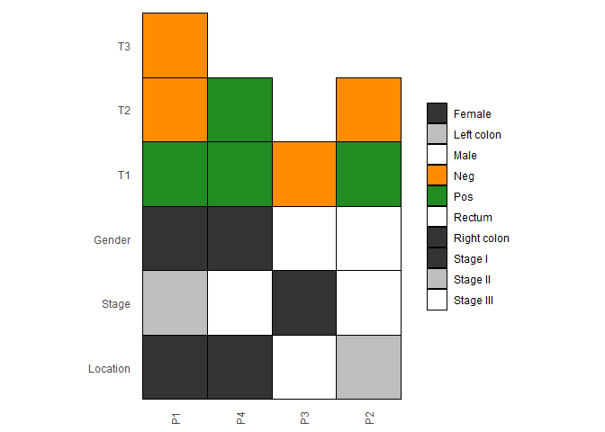

# mrtileplot

<!-- badges: start -->

<!-- badges: end -->

The goal of mrtileplot is to provide a function to create a tile plot
for multiple regions and annotations.

## Installation

You can install the development version of mrtileplot from
[GitHub](https://github.com/) with:

``` r
# install.packages("pak")
pak::pak("LASNunes/mrtileplot")
```

## Example

This is a basic example:

``` r
library(mrtileplot)
## example code

# Example region data
head(example_regions)
#>   patient region value
#> 1      P1     T1   Pos
#> 2      P1     T2   Neg
#> 3      P1     T3   Neg
#> 4      P2     T1   Pos
#> 5      P2     T2   Neg
#> 6      P3     T1   Neg

# Example annotation data
head(example_annotations)
#>   patient annotation annotation_value
#> 1      P1     Gender           Female
#> 2      P1      Stage         Stage II
#> 3      P1   Location      Right colon
#> 4      P2     Gender             Male
#> 5      P2      Stage        Stage III
#> 6      P2   Location       Left colon

# Set colour palette
example_pal <- c(
  "Pos" = "forestgreen", "Neg" = "darkorange", 
  "Female" = "grey20", "Male" = "white", 
  "Stage I" = "grey20", "Stage II" = "grey", "Stage III" = "white", 
  "Right colon" = "grey20", "Left colon" = "grey", "Rectum" = "white")

# Create a tile plot
p <- mr_tileplot(region_data = example_regions, 
                 annotation_data = example_annotations, 
                 palette = example_pal)

plot(p)
```


### Sorting by annotations example

``` r

# Create a tile plot sorted by annotations
p_sorted <- mr_tileplot(region_data = example_regions, 
                        annotation_data = example_annotations, 
                        palette = example_pal,
                        annotation_order = c("Location", "Stage", "Gender"),
                        sort_by = c("Gender", "Stage", "Location"),
                        sort_levels = list(
                          Gender = c("Female", "Male"),
                          Stage = c("Stage I", "Stage II", "Stage III"),
                          Location = c("Right colon", "Left colon", "Rectum"))
                 )

plot(p_sorted)
```


