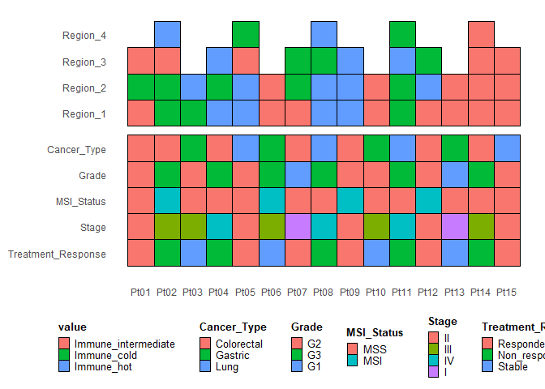
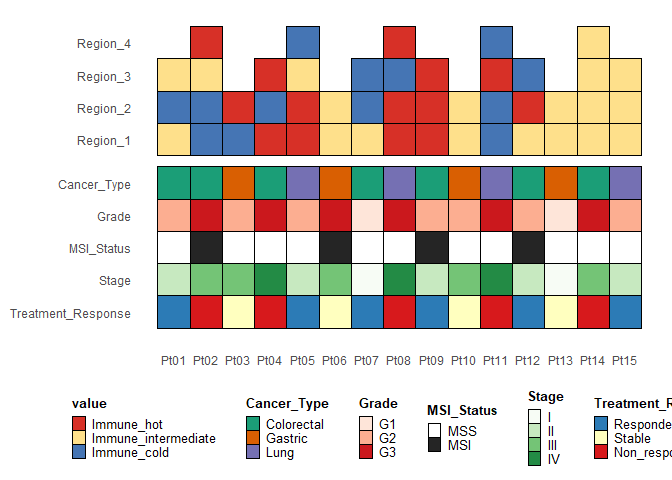
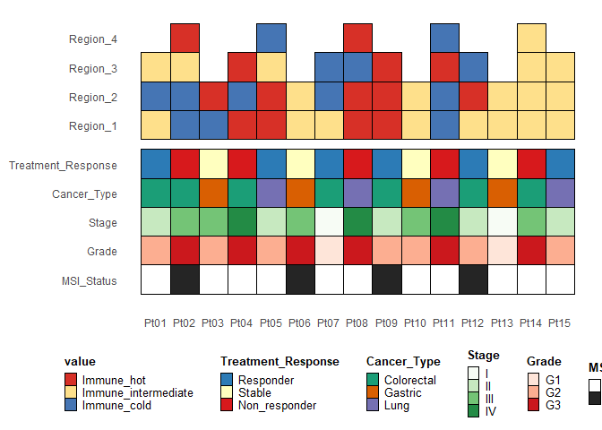
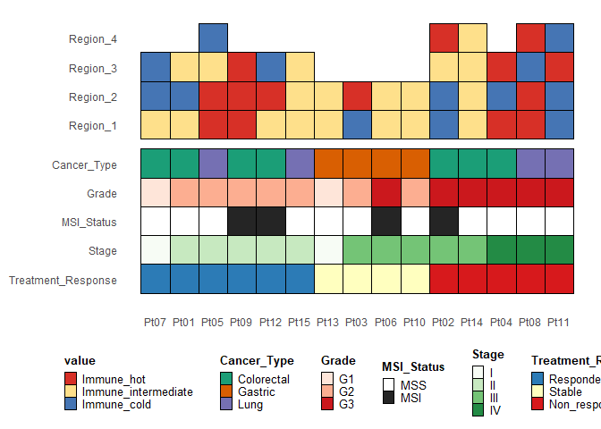
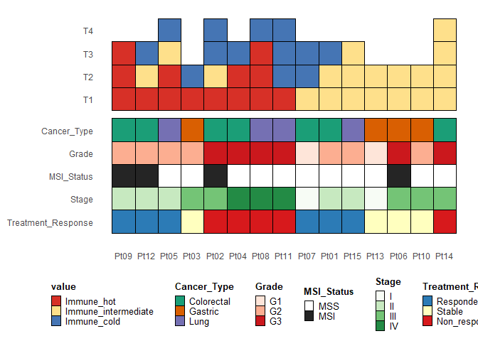
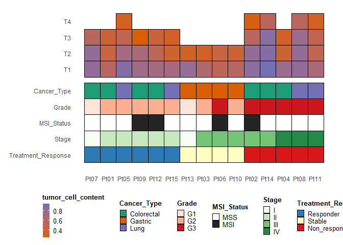

# mrtileplot

<!-- badges: start -->

<!-- badges: end -->

`mrtileplot` is an R package for creating tile plots to visualize
multiregion data. It is designed for datasets where each patient or
tumor has multiple sampled regions, and where region-level values can be
shown together with patient-level clinicopathological or other
categorical annotations.

## Installation

You can install the development version of mrtileplot from \[GitHub\]:

``` r
# install.packages("remotes")
remotes::install_github("LASNunes/mrtileplot")
```

## Example data

The package includes a synthetic cancer-related dataset for examples:

``` r
library(mrtileplot)

# `example_regions` contains one row per patient-region pair:
head(example_regions)
```

    ##   patient   region               value tumor_cell_content
    ## 1    Pt01 Region_1 Immune_intermediate               0.41
    ## 2    Pt01 Region_2         Immune_cold               0.58
    ## 3    Pt01 Region_3 Immune_intermediate               0.44
    ## 4    Pt02 Region_1         Immune_cold               0.85
    ## 5    Pt02 Region_2         Immune_cold               0.28
    ## 6    Pt02 Region_3 Immune_intermediate               0.56

``` r
# `example_annotations` contains one row per patient-annotation pair:
head(example_annotations)
```

    ##    patient         annotation      value
    ## 1     Pt01        Cancer_Type Colorectal
    ## 31    Pt01              Grade         G2
    ## 46    Pt01         MSI_Status        MSS
    ## 16    Pt01              Stage         II
    ## 61    Pt01 Treatment_Response  Responder
    ## 2     Pt02        Cancer_Type Colorectal

### Basic plot

``` r
# Create a tile plot where:
# - columns are patients;
# - regions rows showing region-level values (top);
# - annotation rows showing patient-level variables (bottom).
mr_tileplot(region_data = example_regions, 
            annotation_data = example_annotations
            )
```

<!-- -->

### Adding custom colours

``` r
# Provide separate palettes for region values and annotation values
region_palette <- c(
  "Immune_hot" = "#D73027",
  "Immune_intermediate" = "#FEE08B",
  "Immune_cold" = "#4575B4"
)

annotation_palettes <- list(
  "Cancer_Type" = c(
    "Colorectal" = "#1B9E77",
    "Gastric" = "#D95F02",
    "Lung" = "#7570B3"
  ),
  "Stage" = c(
    "I" = "#F7FCF5",
    "II" = "#C7E9C0",
    "III" = "#74C476",
    "IV" = "#238B45"
  ),
  "Grade" = c(
    "G1" = "#FEE5D9",
    "G2" = "#FCAE91",
    "G3" = "#CB181D"
  ),
  "MSI_Status" = c(
    "MSS" = "#FFFFFF",
    "MSI" = "#252525"
  ),
  "Treatment_Response" = c(
    "Responder" = "#2C7BB6",
    "Stable" = "#FFFFBF",
    "Non_responder" = "#D7191C"
  )
)
mr_tileplot(region_data = example_regions, 
            annotation_data = example_annotations,
            region_palette = region_palette,
            annotation_palettes = annotation_palettes
            )
```

<!-- -->

### Controlling annotation row order

``` r
# Use `annotation_order` to control the order of annotation tracks in the plot.
# This changes only the vertical order of annotation rows.
# It does not sort patients.
mr_tileplot(region_data = example_regions, 
            annotation_data = example_annotations,
            region_palette = region_palette,
            annotation_palettes = annotation_palettes,
            annotation_order = c("Treatment_Response", "Cancer_Type", "Stage", "Grade", "MSI_Status")
            )
```

<!-- -->

### Sorting patients by annotations

``` r
# Use `sort_by` and `sort_levels` to sort patients using annotation values.
mr_tileplot(region_data = example_regions, 
            annotation_data = example_annotations,
            region_palette = region_palette,
            annotation_palettes = annotation_palettes,
            sort_by = c("Treatment_Response", "Stage"),
            sort_levels = list(
              Treatment_Response = c("Responder", "Stable", "Non_responder"),
              Stage = c("I", "II", "III", "IV"))
            )
```

<!-- -->

### Sorting regions whithin patients

``` r
# Use `region_sort_by` and `region_sort_levels` to sort regions within patients.

mr_tileplot(region_data = example_regions, 
            annotation_data = example_annotations,
            region_palette = region_palette,
            annotation_palettes = annotation_palettes,
            sort_by = c("Treatment_Response", "Stage"),
            sort_levels = list(
              Treatment_Response = c("Responder", "Stable", "Non_responder"),
              Stage = c("I", "II", "III", "IV")),
            region_sort_by = "value",
            region_sort_levels = c("Immune_hot", "Immune_intermediate", "Immune_cold"
            ))
```

<!-- -->

``` r
# When regions are sorted, their displayed names are rewritten as consecutive names such as `T1`, `T2`, `T3`, ... This avoids empty spaces between regions from the same patient. The original region names are still kept internally in the plotted data.
```

### Sorting regions without sorting patient by regions

``` r
# Sometimes you may want to sort regions within wach patient but keep patient sorting based only on clinical annotations. Set `sort_patients_by_regions = FALSE`.
mr_tileplot(region_data = example_regions, 
            annotation_data = example_annotations,
            # for continuous region values you need to provide two colours for the gradient
            region_palette = c("#D95F02", "#7570B3"),
            annotation_palettes = annotation_palettes,
            region_value = "tumor_cell_content",
            region_sort_by = "tumor_cell_content",
            region_sort_decreasing = TRUE,
            sort_patients_by_regions = FALSE
            )
```

<!-- -->

### Controlling region-count sorting

When patients have different numbers of samples regions, you can decide
whether the number of regions contributes to patient sorting with
`region_count_sort`. Available options are: - `"after_region"`: sort by
the region variable, then region count, then annotations; - `"last"`:
sort by the region variable, then annotations, then region count; -
`"none"`: ignore region count during patient sorting.

You can also provide the exact patient order manually with
`patient_order`.

## Expected input format

The main region data frame should contain one row per patient-region
pair, with at least three columns: - `patient`: patient or tumor
identifier; - `region`: original region or sample identifier; - `value`:
region-level variable to be shown in the plot (discrete or continuous).

The annotation dataset should contain one row per patient-annotation
pair in the long format, with the following three columns: - `patient`:
patient or tumor identifier; - `annotation`: annotation track name; -
`value`: annotation value.

Column names can be changed using the function arguments:

``` r
mr_tileplot(region_data = example_regions, 
            annotation_data = example_annotations,
            patient = "patient",
            region = "region",
            region_value = "value",
            annotation = "annotation",
            annotation_value = "value"
            )
```

## Citation

If you use `mrtileplot` in your research, please cite it with:

``` r
citation("mrtileplot")
```

    To cite package 'mrtileplot' in publications use:

      Nunes L (2026). _mrtileplot: tile plot for multiregional cancer
      data_. R package version 0.1.0,
      <https://github.com/LASNunes/mrtileplot>.

    A BibTeX entry for LaTeX users is

      @Manual{,
        title = {mrtileplot: tile plot for multiregional cancer data},
        author = {Luís Nunes},
        year = {2026},
        note = {R package version 0.1.0},
        url = {https://github.com/LASNunes/mrtileplot},
      }
