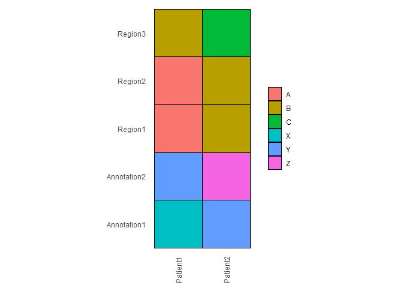

# mrtileplot

<!-- badges: start -->

<!-- badges: end -->

The goal of mrtileplot is to provide a function to create a tile plot
for multiple regions and annotations.

## Installation

You can install the development version of mrtileplot from
[GitHub](https://github.com/) with:

``` r
# install.packages("pak")
pak::pak("LASNunes/mrtileplot")
```

## Example

This is a basic example:

``` r
library(mrtileplot)
## basic example code
region_data <- data.frame(
  patient = rep(c("Patient1", "Patient2"), each = 3),
  region = rep(c("Region1", "Region2", "Region3"), times = 2),
  value = c("A", "A", "B", "B", "B", "C")
)

annotation_data <- data.frame(
  patient = rep(c("Patient1", "Patient2"), each = 2),
  annotation = rep(c("Annotation1", "Annotation2"), times = 2),
  annotation_value = c("X", "Y", "Y", "Z")
)

p <- mr_tileplot(region_data, annotation_data)

plot(p)
```


